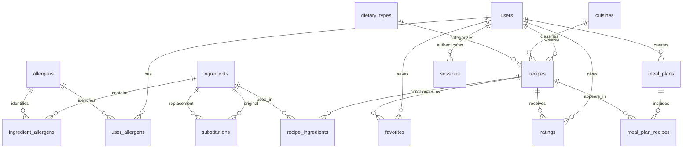

# RecipeRadar | Full Stack DBMS Project

**RecipeRadar is a database-centered recipe discovery and meal-planning application**, built for the DBMS Level-3 Lab. It demonstrates relational modelling, normalized lookup and junction tables, primary and foreign keys, integrity constraints, SQL triggers, views, indexes, transactions, schema migrations and verified database backups in a working application.

The database is the foundation of the project: users, recipes, ingredients, allergies, reviews, favorites and meal plans are stored as related records. The Next.js interface and API read and modify that relational data; the application does not replace the database's integrity rules.

The project follows the supplied RecipeRadar brief and modified relational model. It preserves all 13 source domain tables and attributes, then adds ingredient-to-allergen mapping for specific allergy detection and sessions for authentication. [The database audit](docs/database-audit.md) explains differences between the source drawings and implemented schema, including the meal-plan key decision.

## Run

Requires **Node.js 24 LTS** (uses built-in `node:sqlite`) and npm.

```bash
npm install
npm run dev
```

Open http://localhost:3000. The schema and sample data initialize automatically on first request. No database service, API key, or paid account is required.

Demo login: **demo@reciperadar.app** / **RecipeRadar123!**. You can also register a separate account. Demo recipes belong to the demo user and can be edited through My kitchen.

```bash
npm test          # isolated database integrity tests
npm run build    # production compilation and TypeScript checks
npm start        # serve production build
```

## Features

- Recipe search across names, descriptions and ingredients; cuisine/diet/time filters; rating/time/calorie sorting.
- Recipe detail pages with ingredients, cooking steps, per-serving nutrition, allergen information and flavor recommendations.
- Registration, login, logout, salted scrypt password hashes, hashed opaque session tokens and HttpOnly cookies. Sessions expire after seven days. Writes validate request origins when supplied.
- Persistent per-user favorites, allergy selections, diet preference and calorie target.
- Create, edit and delete recipes with relational ingredient quantities; ownership is enforced by the API.
- One review/rating per user per recipe; rating averages maintained by SQL triggers.
- Ingredient swaps with curated similarity scores and personalized allergen flags.
- Seven-day meal plans with breakfast, lunch and dinner; excludes recipes with recorded allergy conflicts, respects diet category and scales portions toward the calorie target. Generation fails clearly when a meal category has no matching recipes.
- Daily calorie totals and aggregated shopping lists. Plans can be deleted.
- Responsive layout for phone, tablet and desktop.

## Project structure

- `app/page.tsx`: interactive application and forms.
- `app/globals.css`: responsive styling.
- `app/api/[...path]/route.ts`: JSON backend.
- `lib/db.ts`: database initialization, password functions, seed data, queries and transaction helper.
- `db/schema.sql`: tables, foreign keys, checks, indexes and triggers.
- `db/queries.sql`: join, aggregation and nested-query examples for a demonstration.
- `tests/database.test.ts`: isolated test database, password checks, allergen joins, trigger checks and rollback checks.
- `data/reciperadar.sqlite`: auto-created database (ignored by Git).

Set `DATABASE_PATH` to an alternative writable SQLite file if needed. The application requires a persistent Node server and writable disk; ephemeral/serverless hosting will need an external database adaptation. To reset the local sample data, stop the server and delete the `data` directory, then restart. This deletes local accounts, favorites, reviews and plans.

## DBMS design and implementation

The local database is a persistent **SQLite database** at `data/reciperadar.sqlite`. The schema is created and seeded automatically when the app first starts. Node.js 24 uses its built-in `node:sqlite` driver, so no separate database server or paid service is required.

The schema contains 15 STRICT tables: the 13 tables from the modified relational model, plus `ingredient_allergens` and `sessions`. STRICT storage rules, explicit `NOT NULL` declarations, unique and composite keys, and `CHECK` constraints protect data even when a write bypasses the frontend. Foreign keys connect every relationship and define deletion behavior. Indexes support common joins and filters.

Triggers maintain recipe rating averages and ingredient allergen flags, preventing these cached values from drifting away from their source rows. Meal-plan triggers keep meal dates inside each plan's date range. Three SQL views provide ingredient-level allergen details, daily nutrition totals, and portion-scaled shopping lists. Recipe edits, preference changes, and weekly plan generation use transactions to keep related changes atomic.

Schema version 2 is recorded in SQLite's `user_version`. The migration runner saves a consistent backup, upgrades transactionally, verifies row counts and foreign keys, and rolls back if legacy data cannot meet the stronger constraints. Use `npm run db:backup` for a consistent snapshot while the app is running in WAL mode.

This repository includes SQL examples in [`db/queries.sql`](db/queries.sql), the source attribute contract in [`db/model-contract.json`](db/model-contract.json), and the original schema for migration tests in [`db/migrations/001-original.sql`](db/migrations/001-original.sql). The diagram mapping and schema decisions are described in [`docs/database-audit.md`](docs/database-audit.md).

### Relational model

Preserves all 13 tables in the PDF's modified model: `users`, `allergens`, `user_allergens`, `cuisines`, `dietary_types`, `ingredients`, `recipes`, `recipe_ingredients`, `ratings`, `favorites`, `meal_plans`, `meal_plan_recipes`, `substitutions`.

Adds `ingredient_allergens` because a boolean `is_common_allergen` cannot identify which allergy an ingredient represents; adds `sessions` for authentication. Recipe image, meal category and flavor descriptors support discovery and planning. Join tables use composite primary keys. Meal slots are unique per plan/date/type. Foreign keys prevent orphan records, transactions keep multi-table writes atomic, and CHECK constraints validate ratings, quantities and nutrition. Unique constraints prevent duplicate accounts, favorites and reviews. `avg_rating` is the model's denormalized derived field and stays synchronized with triggers.



The source ER drawing omits `favorites`, which appears in its relational model; RecipeRadar includes it. The implemented meal-entry key is `(plan_id, meal_date, meal_type)`: it enforces one recipe per slot and allows a recipe to recur on another day. See the audit for details.

## API

All writes accept JSON and return `{ok:true}` or `{error:string}`; account endpoints return user data. Private operations derive ownership from the session, never a client-provided user ID.

| Method | Endpoint             | Purpose                                                       |
| ------ | -------------------- | ------------------------------------------------------------- |
| GET    | `/api/bootstrap`     | Recipes, lookups and current user                             |
| POST   | `/api/auth`          | `mode: login/register/logout`, email, password, optional name |
| POST   | `/api/profile`       | name, diet_goal, daily_calorie_target, allergen ID array      |
| POST   | `/api/favorite`      | Toggle recipe_id                                              |
| POST   | `/api/recipe`        | Create/update recipe; optional recipe_id                      |
| POST   | `/api/recipe-delete` | Delete owned recipe_id                                        |
| POST   | `/api/rating`        | recipe_id, rating (1–5), review                               |
| GET    | `/api/reviews/:id`   | Public reviews                                                |
| GET    | `/api/substitutions` | Ingredient alternatives and allergen conflicts                |
| GET    | `/api/plans`         | Current user's plans and meals                                |
| POST   | `/api/plan`          | Generate plan from ISO start_date                             |
| POST   | `/api/plan-delete`   | Delete owned plan_id                                          |

## Scope and limitations

This is a locally runnable academic project, not a clinical nutrition service. Allergen checks cover explicit ingredient mappings only, not packaging or cross-contact. Starter nutrition and recipes are demonstration data, not laboratory-verified measurements. Flavor similarity uses Jaccard overlap of curated descriptors; substitution scores are curated estimates, not embeddings or a trained semantic model. Meal planning is deterministic and calorie-based, not a clinical optimizer. Diet categories follow the PDF's single diet foreign key, so a Vegan filter matches recipes explicitly classified Vegan. Sample recipe photos use Unsplash and web fonts use Google Fonts; the app remains usable with system fonts when offline, but remote photos need connectivity. No hosted deployment, email verification, password recovery, production rate-limit service or admin moderation console is included. For a public deployment, add these account protections and replace the shared demo credentials.

Next.js API design follows the official [Route Handlers](https://nextjs.org/docs/app/api-reference/file-conventions/route) and [cookies](https://nextjs.org/docs/app/api-reference/functions/cookies) documentation.

## Optional Docker run

```bash
docker compose up --build
```

Open http://localhost:3000. The named `recipe-data` volume persists your database across container replacement. The Docker setup is included for convenience; local Node execution is the verified run path.

To run HTTP integration checks against an already running local server:

```bash
npm run test:api
```

These create a disposable account and test review in the active database. Prefer a throwaway `DATABASE_PATH` when running them repeatedly.

## Database verification and backups

The database has been hardened to schema **v2** with STRICT tables, explicit non-null foreign keys, validated date ranges, synchronized rating/allergen caches and indexed relationships. Existing v1 data upgrades atomically with a consistent backup first.

Read [the diagram mapping and audit](docs/database-audit.md) for the exact preserved attributes, intentional changes, normalization tradeoffs and remaining boundaries. [The verification report](docs/database-verification.json) records a point-in-time check of the actual local database. The audit does not certify the absence of every possible defect.

```bash
npm run db:audit
npm run db:audit -- docs/database-verification.json
npm run db:backup
npm test
```

`lib/migrations.ts` owns schema upgrades; `db/model-contract.json` lists the PDF's original attributes; `db/migrations/001-original.sql` retains the original implementation for migration tests. The live database is `data/reciperadar.sqlite`. Inspect it with a SQLite-aware client; do not copy just that file while WAL writes may be active. Backups contain account data and should remain private.
